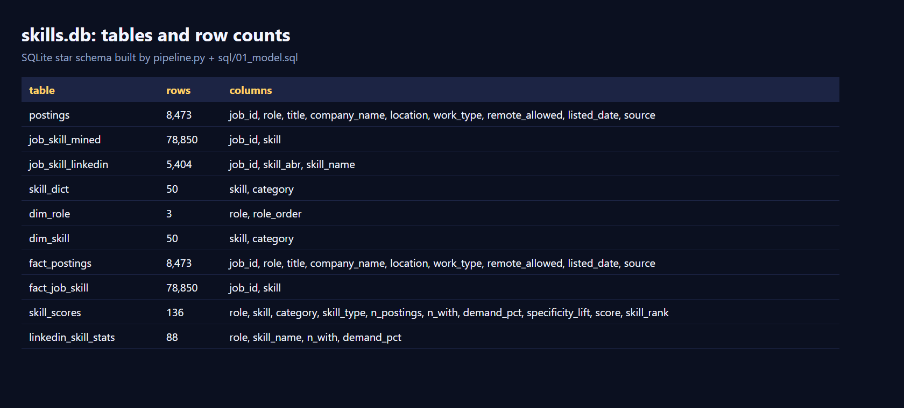
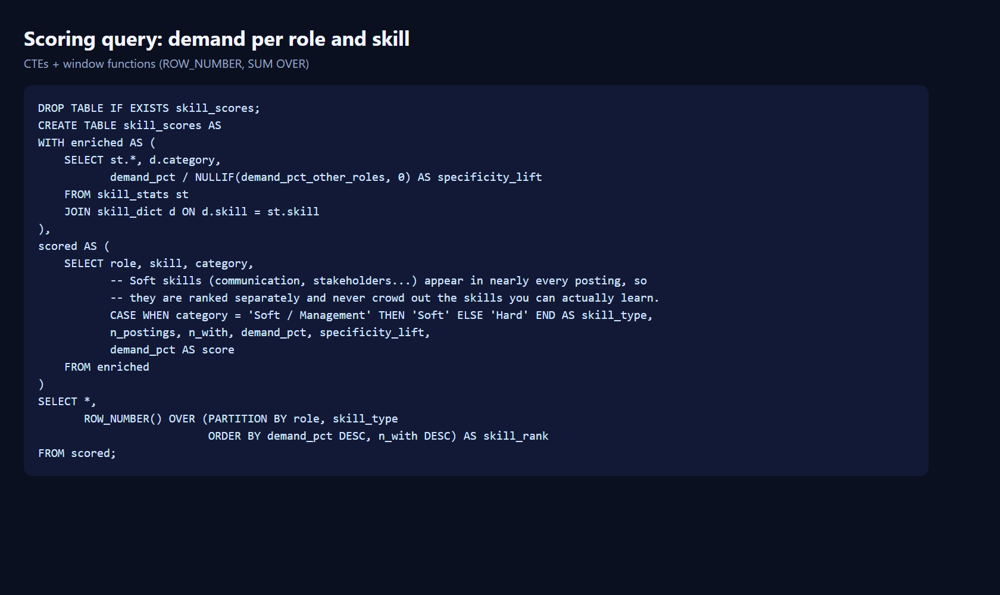
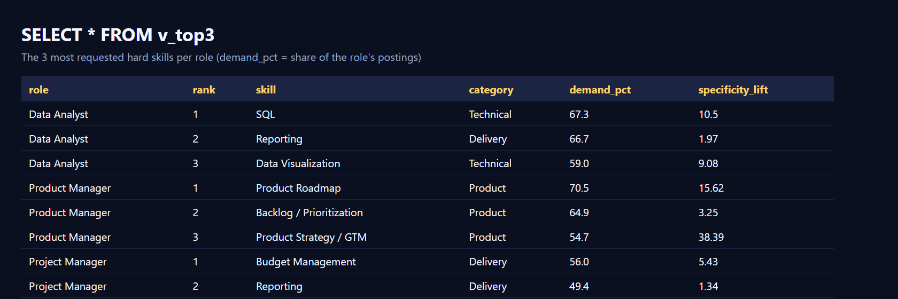
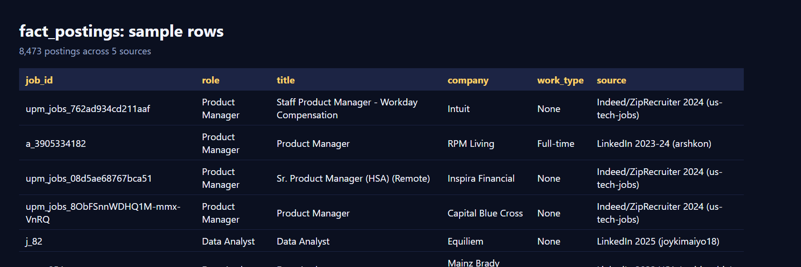

# Which 3 skills should you learn to become a Data Analyst, Product Manager or Project Manager?

**[Live dashboard](https://oriyakli1-ui.github.io/linkedin-skills-analysis/)** · Power BI project: [`powerbi/project/LinkedInSkills.pbip`](powerbi/project) · [Carousel slides](carousel/slides)

## The database (SQLite, `out/skills.db`)
| Tables and row counts | The scoring query |
|---|---|
|  |  |





## Repo map
- `pipeline.py` collects, cleans and classifies postings, then builds `out/skills.db` and `out/powerbi/*.csv`
- `sql/` the star-schema model and the scoring query
- `powerbi/` PBIP report, DAX measures, Power Query loader, build guide
- `dashboard/`, `docs/index.html` the web dashboard (GitHub Pages serves `docs/`)
- `carousel/` LinkedIn carousel (1080x1350 PNGs)
- `tests/` synthetic sample data for running the pipeline without the Kaggle files
- `data/` is not in the repo (1.3 GB of Kaggle downloads); fetch the datasets listed above into `data/raw` and `data/raw_extra`

An end-to-end SQL + Power BI project built on ~8,500 real job postings (1,620 Data Analyst, 4,684 Product Manager,
2,169 Project Manager) from LinkedIn (2022-2025) and Indeed/ZipRecruiter (2024). Skill demand is nearly identical
across the two sources (correlation 0.98-0.99 per role). For each role it ranks the skills
named in postings and answers one question: **"If I want this job, which 3 skills help me most?"**

## Why postings, not profiles
Skills requested by employers are public, structured and aggregated - no personal data, no scraping of people.

## Data
Kaggle: *LinkedIn Job Postings (2023-2024)* (`arshkon/linkedin-job-postings`). Postings are filtered to the three
roles by title (construction / facilities project managers and ambiguous hybrid titles are excluded).
Skills come from two sources: LinkedIn's own skill categories on each posting, and ~50 specific skills mined from the
description (SQL, Jira, A/B testing, ...).

## Method (`sql/02_skill_scores.sql`)
For each role x skill, the ranking is simply **the share of that role's postings that mention the skill**.
For context, each skill also shows how much more common it is in this role than in the other two roles
(a high multiple means the skill defines the role; a low one means every role wants it). Soft skills (communication, stakeholders)
are ranked separately because every posting lists them. Skills with < 20 postings are dropped.

## Run it
```
python pipeline.py --data-dir data/raw --extra-dir data/raw_extra   # builds out/skills.db + out/powerbi/*.csv
python show_top3.py out/skills.db
```
Then follow `powerbi/POWERBI_GUIDE.md`.

## Limitations (say them in the post)
- Postings show what employers *ask for*, not what people *have*.
- Skill extraction is keyword-based and can miss synonyms.
- Mostly US postings; snapshot from 2023-2024.
